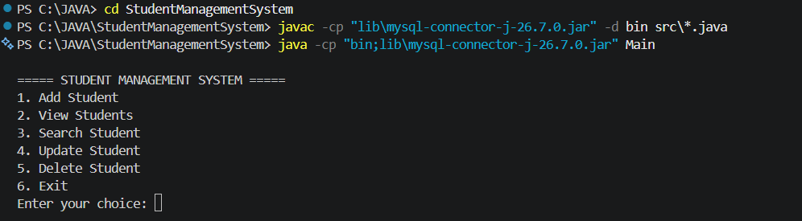
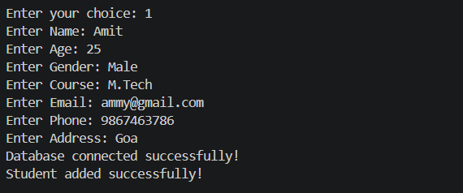
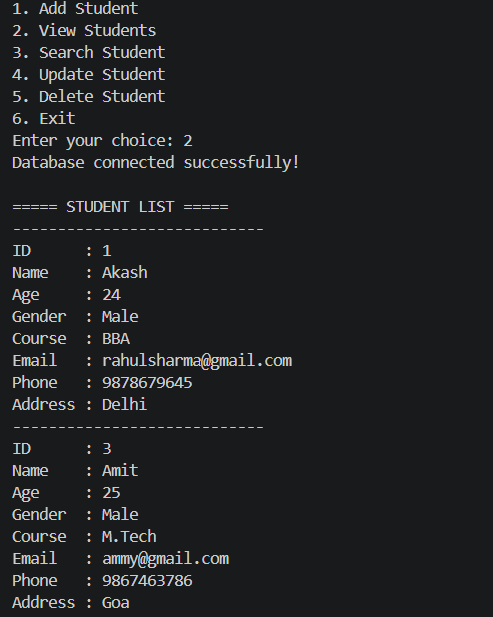
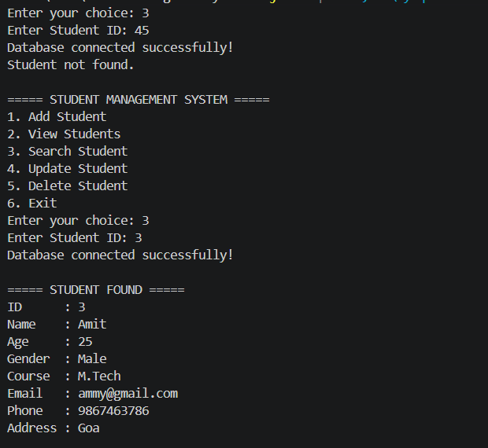
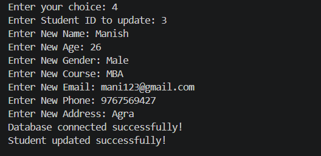
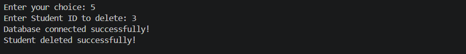
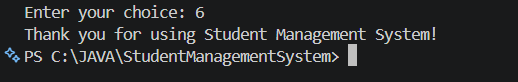
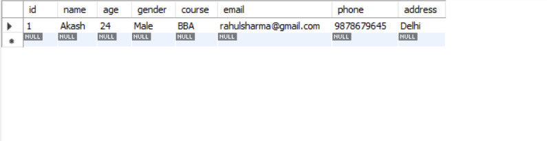

# Student Management System

## 1. Project Overview

The Student Management System is a console-based application developed using Java and MySQL. It is used to store and manage student information efficiently.

The system allows the user to add, view, search, update, and delete student records.

## 2. Technologies Used

- Java
- MySQL
- JDBC
- MySQL Connector/J
- Visual Studio Code

## 3. Features

The system provides the following features:

1. Add Student
2. View Students
3. Search Student
4. Update Student
5. Delete Student
6. Exit

## 4. Student Information

The system stores the following information:

- Student ID
- Name
- Age
- Gender
- Course
- Email
- Phone
- Address

## 5. Database

Database Name:

`student_db`

Table Name:

`students`

The application connects to MySQL using JDBC.

## 6. Project Structure

```text
StudentManagementSystem/
│
├── .vscode/
│   └── settings.json
│
├── lib/
│   └── mysql-connector-j-26.7.0.jar
│
├── src/
│   ├── DbConnection.java
│   ├── Main.java
│   ├── Student.java
│   └── StudentDAO.java
│
├── database/
├── screenshots/
├── README.md
└── Project_Report.pdf
```

## 7.  Application Screenshots
















